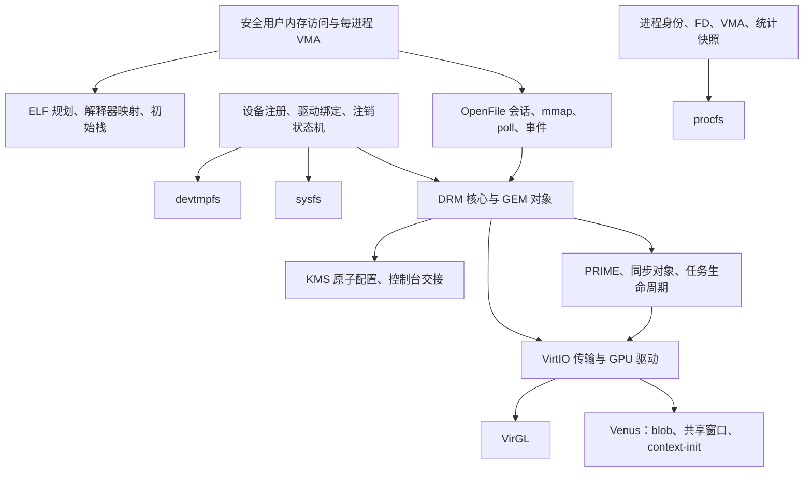

# SpaceOS-9 子系统调研与实施契约

日期：2026-10-24，2026-10-25 更新。状态：选型已完成；首轮内核实现与验收结果见“当前实现与验收状态”，本文的契约条目本身不代表全部实现。

本地调查基于 `a99657f86dddcb38b89d00d75131168944cd1e4b` 及当时工作区；该段是 2026-10-24 的调查记录。2026-10-25 的实现工作在该基线上继续，未提交改动见 `git status`。

## 已完成的仓库操作

远端仓库已从 `ViudiraTech/SpaceKernel` 改为 [ViudiraTech/SpaceOS-9](https://github.com/ViudiraTech/SpaceOS-9)，并已于 2026-10-25 切换为公开仓库（`visibility: public`）。本地 `origin` 的 fetch/push 地址均已更新。

本轮没有修改 Cargo 包名、镜像名或工作区目录名；内核功能源码的改动从 2026-10-25 的实现轮次开始。

## 用户已确定的选型

| 决策 | 最终选择 | 实施含义 |
| --- | --- | --- |
| 操作系统兼容目标 | 保留并完善 Linux ABI | 延续现有系统调用基础，补齐实际行为；不把已有编号当作已支持 |
| 显卡用户接口 | Linux DRM/KMS ioctl 语义 | 撤回最初的原生显卡协议方案；兼容编号、布局、权限、返回值和生命周期 |
| 首批图形能力 | VirtIO 3D，同时包含 VirGL 和 Venus | OpenGL/Vulkan 所需内核接口都在首批范围；不能以 2D 或提交接口空壳替代 |
| 用户态工作 | 暂缓 | 本轮不移植 libc、ld.so、Mesa、窗口系统；保留后续接入需求和测试契约 |
| ELF | 选择内核完善静态、PIE、PT_INTERP 的路线 | 内核准备可交给用户态解释器的进程映像；用户态动态链接器暂缓 |
| 架构顺序 | 共享核心覆盖三架构，x86_64 先完成设备链路 | 三目标持续编译和启动回归；AArch64/RISC-V 后续分别完成功能验收 |

用户最初选择兼容 Linux、显卡采用原生协议，随后明确改为 Linux ioctl。以后一项为准。用户要求“用户态先别管”，因此此前选项中的 musl/动态链接器移植不作为本轮实施工作。

## 成熟实现与取舍

### 显卡

| 参考 | 调研结论 | SpaceOS-9 的取舍 |
| --- | --- | --- |
| [Linux KMS](https://docs.kernel.org/next/gpu/drm-kms.html) | 原子配置先校验，再提交；校验阶段不改变硬件 | 采用其外部语义，Rust 内部结构按本项目所有权和锁模型实现 |
| [Linux DRM UAPI](https://docs.kernel.org/gpu/drm-uapi.html) | 覆盖设备节点、master、render node、映射、事件和拔除行为 | 作为兼容契约；为每个声称支持的 ioctl 建立行为测试 |
| [Linux DRM 内存管理](https://docs.kernel.org/gpu/drm-mm.html) | 缓冲区、同步和执行调度各有独立生命周期 | 区分对象引用、映射引用和在途任务引用，避免关闭句柄提前释放 backing |
| [Linux VirtIO ioctl 实现](https://github.com/torvalds/linux/blob/master/drivers/gpu/drm/virtio/virtgpu_ioctl.c) | GPU 专用 ioctl 与通用 DRM 接口组合使用 | 对照 UAPI 与 VirtIO 命令逐项建立映射，不能只实现 KMS |
| [Fuchsia Display Coordinator](https://fuchsia.dev/fuchsia-src/development/drivers/driver_guides/display/config-states) 与 [Magma](https://fuchsia.dev/fuchsia-src/development/graphics/magma) | 提供另一种显示配置、ready fence 和 GPU 客户端/系统驱动分工参考 | 用于内部状态机审查；不再采用 Fuchsia 风格的对外协议 |
| [SerenityOS 图形子系统](https://github.com/SerenityOS/serenity/blob/master/Documentation/Kernel/GraphicsSubsystem.md) | 有 connector 设备和 framebuffer 接管设计；文档也说明访问控制方面的限制 | 参考启动显示与控制台交接，不视为完整 Mesa/DRM 兼容实现 |

选择：依据 Linux UAPI 和 VirtIO 规范实现 Rust 子系统；当前不引入完整 Linux 驱动兼容运行时。后者还需要适配 Linux 的设备、内存、同步和执行环境，超出单纯复用驱动代码的成本。

### VirtIO 3D 的两条链路

[Mesa VirGL](https://docs.mesa3d.org/drivers/virgl.html) 面向虚拟机中的 OpenGL 加速；[Mesa Venus](https://docs.mesa3d.org/drivers/venus.html) 使用 Vulkan 命令序列化协议。Venus 明确要求 guest 驱动支持 `3D_FEATURES`、`CAPSET_QUERY_FIX`、`RESOURCE_BLOB`、`HOST_VISIBLE`、`CONTEXT_INIT` 等参数。

[QEMU VirtIO GPU 文档](https://www.qemu.org/docs/master/system/devices/virtio/virtio-gpu.html) 区分 2D、virglrenderer 和 rutabaga 等后端。当前选择 virglrenderer 提供 VirGL/Venus，先不额外引入 rutabaga/gfxstream。具体宿主 Vulkan、共享内存和缓存属性要求要按 Mesa Venus 文档及测试宿主实际能力核验。

硬件协议依据 [OASIS VirtIO 1.3 的 GPU 章节](https://docs.oasis-open.org/virtio/virtio/v1.3/virtio-v1.3.html)。GPU 命令、资源与队列完成语义不能直接等同于 Linux ioctl；需要显式转换层。

### devtmpfs、procfs、sysfs

- [Linux devtmpfs 实现](https://github.com/torvalds/linux/blob/master/drivers/base/devtmpfs.c)：设备节点跟随设备核心注册/删除，并保留内存文件系统的目录与节点管理能力。现有纯动态枚举 devfs 不具备同等行为。
- [Linux procfs 文档](https://docs.kernel.org/filesystems/proc.html)：进程目录、身份、文件描述符及退出后的引用语义是核心契约。
- [seq_file 文档](https://docs.kernel.org/6.19/filesystems/seq_file.html)：为长输出、小块读取和定位提供成熟参考。SpaceOS-9 应明确每次打开的快照或迭代会话语义。
- [Linux sysfs 文档](https://docs.kernel.org/filesystems/sysfs.html)：设备对象、属性回调及拓扑链接构成其基础。SpaceOS-9 使用自身设备模型，不需要为了相同的用户接口复刻 kobject 内部实现。

选择：先建立统一设备注册表和虚拟节点基础，再由 devtmpfs/sysfs 投影；procfs 从进程、内存和统计接口取数。三者共享一致的对象身份和生命周期，避免各自维护一份失去同步的设备或进程清单。

### ELF

[ELF gABI Program Loading](https://gabi.xinuos.com/elf/07-pheader.html) 定义段布局与对齐；[Dynamic Linking](https://gabi.xinuos.com/elf/08-dynamic.html) 定义解释器参与进程启动的分工。实际实现参考 [FreeBSD imgact_elf.c](https://cgit.freebsd.org/src/tree/sys/kern/imgact_elf.c) 的校验、地址布局与装载组织。

选择：内核验证与映射主程序和解释器，提供正确入口、栈及辅助向量；共享库搜索、符号解析和通用动态重定位由用户态解释器负责。无解释器的静态 PIE 需要明确支持由启动代码自重定位的 ABI，不把任意 `ET_DYN` 当成可以直接运行的程序。

musl 官方源码页面本轮访问超时；不将其完整源码审计列为已完成工作。本轮不以运行 musl/Mesa 作为已满足的结果。

## 本地代码调查：必须先处理的基础问题

| 位置 | 当前事实 | 对目标的影响 |
| --- | --- | --- |
| `src/vfs/mod.rs` | `devtmpfs` 被映射为 `DevFs::new()`，没有 sysfs 挂载类型 | 需要真实文件系统实现和挂载集成 |
| `src/vfs/devfs.rs` | 特殊设备硬编码，块设备动态查找；没有通用可变目录和设备注销契约 | 不足以承载 `/dev/dri`、权限变更及热插拔 |
| `src/vfs/devfs.rs` | `random/urandom` 来自时间种子伪随机序列 | 不能作为可靠熵源支持 ELF 的安全随机或用户程序 |
| `src/vfs/procfs.rs` | 每次读取重新生成文本；任意数字目录可 lookup；`self` 为目录 | 缺少稳定读取、PID 存在性与符号链接语义 |
| `src/vfs/procfs.rs` | CPU 统计含常量零，diskstats 返回缓存统计格式 | 不可据此宣称 Linux 工具兼容；需真实取数和正确格式 |
| `src/vfs/inode.rs`、`fd.rs` | inode 接口没有完整的每次打开设备会话、mmap、poll、属性修改支持 | DRM 会话和事件必须扩展 open-file 层，不能把每个 inode 当成单个会话 |
| `src/user/elf.rs` | `e_phentsize` 未严格验证；表范围使用该值，实际读取固定大小结构 | 截断或恶意 ELF 可触发超出切片的读取 |
| `src/user/elf.rs` | 文件/地址范围存在未检查加法；逐段映射可能撞到同一页 | 需要先验证并生成按页装载计划，再实施映射 |
| `src/user/elf.rs` | 接受 `ET_DYN`，但没有 load bias、解释器和完整入口校验 | 不是完整 PIE/动态 ELF 支持 |
| `src/user/stack.rs` | 只支持单个程序名；向顶页直接写字符串；`AT_RANDOM` 为固定字节 | 需要有界跨页写入、参数环境、辅助向量和熵接口 |
| `src/user/address_space.rs` | 有基本 map/drop，缺少完整的范围映射、保护修改与撤销接口 | ELF 失败回滚、RELRO 和 GPU 映射依赖这些接口 |
| `src/syscall/mod.rs` | `mmap/munmap` 没有分发，`brk` 只更新全局数字 | 需要真实的每进程 VMA 和内存操作 |
| `src/syscall/mod.rs` | 用户字符串和若干参数直接解引用 | ioctl 中的嵌套用户数组必须建立可返回 EFAULT 的访问层 |
| `src/pci/mod.rs` | 枚举结果是初始化后的设备快照 | 完整动态设备生命周期需要扩展现有模型 |

以上属于代码审阅结论，尚未通过新测试复现。README 对多个近期模块的描述已滞后，不能用它作为功能支持清单。

## 目标结构

该图为建议的实现依赖，不表示已有模块，也不冻结未验证的内部 API 名称。

## DRM/KMS 兼容契约

ABI 定义以 [drm.h](https://github.com/torvalds/linux/blob/master/include/uapi/drm/drm.h)、[drm_mode.h](https://github.com/torvalds/linux/blob/master/include/uapi/drm/drm_mode.h)、[virtgpu_drm.h](https://github.com/torvalds/linux/blob/master/include/uapi/drm/virtgpu_drm.h) 和 [virtio_gpu.h](https://github.com/torvalds/linux/blob/master/include/uapi/linux/virtio_gpu.h) 为核对来源。实施开始时固定具体上游提交及本地 ABI 清单，避免跟随浮动 master 改变契约。

1. `/dev/dri/cardN` 与 `renderD128+N` 使用各自权限和 ioctl 允许列表。显示 master 与 render 客户端分离；每个打开的文件描述有独立会话，dup 共享该会话，最后一个引用释放时执行关闭流程。
2. ioctl 编号含方向和结构尺寸；布局使用明确宽度、对齐及 padding，并在三目标验证。检查嵌套指针、数量乘法、长度和保留字段；失败返回与对应 Linux UAPI 一致的错误。
3. GEM 句柄属于会话；对象、FB、映射、共享导出和在途任务各自持有引用。mmap offset 不能成为绕过对象访问控制的全局地址。
4. KMS 具有 connector/encoder/CRTC/plane、mode/property/blob、framebuffer、dumb buffer、基础 modeset/page flip 与 atomic 接口。`TEST_ONLY` 不改硬件或公开活动状态；非阻塞提交有明确排队、完成和错误路径。
5. PRIME 导入导出与 dma-buf 映射/同步有一致所有权；syncobj 支持 binary/timeline，sync-file 与事件等待按声明的能力实现。完成不能只表示命令已入队；host fence 的完成/错误必须传回等待者。
6. 事件读取、poll、非阻塞行为、队列上限及溢出处理可测试。VirtIO 无真实垂直同步通知时，必须明确其 page-flip/vblank 时间语义，不能伪称硬件时间戳精度。
7. 关闭文件、进程退出、设备移除、reset 和超时全部进入有界清理路径；先阻止新提交，终结等待和在途任务，再撤销映射/资源。待 DMA 完成或确定已停止后才能释放 backing。
8. GPU 调度不能占着关中断自旋锁等待 host。使用任务上下文及等待队列，约定提交、对象、设备和队列锁顺序。
9. `GET_CAP`、`GETPARAM`、capset 和 feature negotiation 只报告实际可用能力；不支持的扩展走真实错误路径，绝不返回成功占位。

该契约覆盖通用子系统和选定 VirtIO 后端，不等于已经实现所有厂商 GPU 驱动、所有 Linux 图形历史接口或完整 OpenGL/Vulkan 用户态规范。

## VirtIO 后端工作清单

| 层 | 必须交付的行为 |
| --- | --- |
| 传输 | PCI capability/BAR 校验、现代 VirtIO feature negotiation、split virtqueue、DMA 地址与屏障、通知和 IRQ 完成；复位时解除在途访问 |
| 2D 与启动 | display info、资源 backing、transfer/flush、scanout、cursor、EDID、配置变化；与 Limine framebuffer/fbcon 明确交接 |
| 3D 公共 | capset 查询和缓存、context create/destroy、resource attach/detach、3D resource/transfer、命令提交、fence/错误关联 |
| Linux 专用 ioctl | MAP、EXECBUFFER、GETPARAM、RESOURCE_CREATE/INFO、TRANSFER_TO/FROM_HOST、WAIT、GET_CAPS、RESOURCE_CREATE_BLOB、CONTEXT_INIT；字段及扩展以固定头文件逐项核对 |
| VirGL | VirGL/VirGL2 capset、资源及渲染上下文、命令流传输、完成 fence；不在内核重写 Mesa shader compiler |
| Venus | 对应 capset、context-init、多 ring/timeline、blob 创建、host-visible region 分配与映射、缓存属性及可用范围校验 |
| 恢复 | host 错误、队列耗尽、超时、reset、关闭会话与资源销毁的竞态；设备恢复后旧句柄不能误指新资源 |

x86_64 先验收现代 PCI 传输；AArch64/RISC-V 按其 QEMU 机器配置分别验证 PCI 或 MMIO 接入。CPU 架构无关的核心编译通过不等于对应传输已经运行验证。

## 三个虚拟文件系统的完整性要求

| 子系统 | 数据与操作 | 生命周期与失败路径 |
| --- | --- | --- |
| devtmpfs | 真正的可变目录树，自动设备节点、稳定 inode/rdev、子目录、符号链接、必要的节点/属性操作；标准字符设备、TTY、块设备、DRM 节点接入 | 注册/删除原子可见，名称冲突回滚，权限检查，已打开但被注销设备的 I/O 行为；用户修改不能被重新 lookup 静默重置 |
| procfs | `self`/`thread-self`、PID/TID、task、fd/fdinfo、cwd/exe/root、cmdline/environ、status/stat/statm、maps/auxv；系统级 CPU/内存/uptime/mounts/filesystems/partitions/diskstats | PID 代际身份、进程退出、权限和敏感信息隔离；每次打开的读取/seek 契约，短读与并发变化；缺少底层数据时补齐取数来源 |
| sysfs | devices/bus/class/dev 视图、驱动绑定关系、PCI 属性、块设备容量/分区、DRM connector/mode/status 等属性与链接；为后续 libdrm 发现设备提供一致信息 | 对象有父子引用和注销状态，属性回调不访问已销毁设备，写属性有权限和输入校验，链接不形成悬空身份 |

内核设备事件接口属于完整设备模型的一部分；未来 udev 所依赖的事件传输需列入兼容矩阵。未实现 netlink/udev 用户态时，不能把已有 sysfs 路径宣称为完整 udev 兼容。

## ELF 装载契约

1. 首先纯解析并验证，再生成装载计划。检查 ELF/version/header size、目标架构及 flags、程序头尺寸/数量/范围、文件与地址运算溢出、用户地址边界、入口是否落在可执行段、文件与内存长度、对齐关系和受限资源总量。
2. 处理空段、零文件长度、BSS、跨页数据和合法共享边界页；拒绝冲突布局。按页合并映射计划并明确权限策略，不能重复分配同一用户虚拟页，也不能意外将数据段变成可写可执行。
3. 区分 `ET_EXEC`、静态 PIE 和解释器 ELF；为 `ET_DYN` 选择有界且不冲突的 load bias。ASLR 依赖真实熵；熵不可用时不得伪报随机化成功。
4. 处理 `PT_INTERP` 的长度/NUL/路径校验，装载相应解释器，禁止递归解释器；区分主程序 entry 和实际初始 PC。`PT_PHDR`、`PT_TLS`、`PT_GNU_STACK`、`PT_GNU_RELRO` 均有明确处理契约。
5. 栈支持有界 argv/envp 和跨物理页写入，维护各架构 psABI 对齐、guard page、不可执行栈及正确指针。辅助向量包含实际 PHDR/PHENT/PHNUM、PAGESZ、BASE、ENTRY 和按兼容契约提供的身份、平台、随机数据等字段。
6. TLS 模板/线程指针与架构上下文衔接；动态 TLS、符号查找和共享库重定位由未来 ld.so 完成。RELRO 需要可实际修改页权限的内核接口，不能只解析记录。
7. 装载失败释放未发布映像和所有暂存页；执行映像替换的提交点明确。现有进程不因失败失去原映像。提交时处理 CLOEXEC、每进程 brk/VMA、栈、凭据与需要重置的进程状态。
8. 用户态 ld.so/Mesa 暂缓；内核验收可使用最小汇编 ELF/ABI 探针作为测试载荷，这与建设完整用户态系统区分记录。

## 实施顺序与可核验结果

下列里程碑是依赖顺序，全部属于整体目标；前一项通过不代表后续项完成。

| 里程碑 | 核心结果 | 验收证据 |
| --- | --- | --- |
| M0：基础正确性 | 用户内存访问、VMA、真实 mmap/munmap/mprotect/brk、进程资源所有权、每次打开会话 | 非法/跨页指针返回 EFAULT；失败回滚、权限及进程隔离测试 |
| M1：设备与虚拟树 | 设备注册/注销、公共节点基础、devtmpfs/sysfs/procfs | 挂载及路径操作、读写/seek、注册注销并发、PID 退出与权限测试 |
| M2：ELF | 解析与映射计划、静态/PIE、解释器、初始栈/auxv/TLS 元数据 | 三架构格式用例与启动载荷；坏输入不 panic、不污染旧映像、不泄漏物理页 |
| M3：DRM 核心 | ABI、会话、GEM、PRIME/sync、事件、KMS 与控制台接管 | 结构布局与编号核对、双客户端隔离、atomic TEST_ONLY、关闭和解绑压力测试 |
| M4：VirtIO 2D/3D | 传输、显示、VirGL 与 Venus 内核链路 | x86_64 QEMU 真实队列命令/响应、资源读写、host fence、blob 映射及复位测试 |
| M5：跨架构与加固 | AArch64/RISC-V 功能补齐、故障注入与长时间压力 | 各架构独立功能记录；三目标构建/启动矩阵；失败、超时、低内存与资源耗尽无悬挂 |
| 后续用户态集成 | libc/ld.so/libdrm/Mesa 和应用 | 用户另行恢复该范围后，以实际 OpenGL/Vulkan 程序运行验证；当前不标为已验收 |

通用检查沿用仓库 `make check`、相应 `make test ARCH=...` 及调度回归。GPU 新增检查必须覆盖真实 VirtIO IRQ/队列路径；宿主缺少 GL/Vulkan 能力时记录为未验收，不用纯模型结果替代硬件协议验证。

“工业级”的交付记录必须包括：明确支持矩阵、状态/锁/所有权契约、正常与失败路径测试、资源回收证据和已知限制。具体 Linux/Mesa/libdrm/QEMU 版本与 ioctl 清单在实施时固定并记录；不能以函数数量、文件数量或单次 BOOT_OK 代替这些证据。

## 当前实现与验收状态

以下状态以 2026-10-25 工作区的实际代码和本轮实际执行的命令为准。未执行过的项目不写成已验证；`make test` 的每一行由 `tools/test_matrix.py` 从子进程真实退出码和 `qemu_test.py --result` 生成的 JSON 汇总，不再使用硬编码 PASS。测试宿主为 QEMU 11.1.2、libvirglrenderer 1.3.0；x86_64 使用 OVMF，AArch64 使用 AAVMF，RISC-V 使用 RISCV_VIRT。QEMU 只提供虚拟 GPU，不能代替真机验收。

### 实现且已验证

| 范围 | 实际实现/行为 | 验收证据 |
| --- | --- | --- |
| 构建与格式 | 三目标 `--all-features` 编译；`cargo fmt`；GPU 测试目标不含 SIMD 指令 | `make check` 通过（`x86_64-unknown-none`、`aarch64-unknown-none-softfloat`、`riscv64imac-unknown-none-elf`） |
| 三架构启动与 SMP | QEMU 启动、4/4 CPU online、自测和 `BOOT_OK` | `make test`：host 3/3 + x86_64/aarch64/riscv64 3/3 PASS（2026-10-25） |
| 调度模型 | EEVDF 纯模型测试 | `make test-sched-model`：1/1 |
| ELF/用户内存模型 | 头部/程序头校验、PIE load bias、PT_INTERP、RELRO/TLS、越界和截断拒绝 | `make test-subsystem-model`：11/11 |
| Linux DRM ABI 布局 | UAPI 编号和结构尺寸探针 | `make test-drm-abi` |
| Linux ABI 用户态 | 静态 ELF 执行、退出码 42、PIE/PT_INTERP 交接、用户内存边界 | 三架构 `SELFTEST_OK ... user_elf=ok` |
| 设备与虚拟文件系统 | devtmpfs/sysfs/procfs、设备注册/注销、节点读写 | `SELFTEST_OK ... vfs_abi=ok dev_sys_proc=ok`；这是内核自测，不是 Linux 工具兼容验收 |
| 块设备与文件系统 | IDE/AHCI/NVMe、分区扫描、FAT32 挂载 | 启动日志和 `block=ok` |
| 三架构 FPU/上下文 | 上下文切换、FPU 状态、soft-float 构建 | `cpu_fpu=ok`、`tools/check_no_simd.py` |
| x86_64 VirtIO GPU 2D/KMS | 控制/光标队列、IRQ、GEM/PRIME、syncobj、KMS atomic `TEST_ONLY`/commit/event/out-fence、dumb/fb/cursor、blob、资源回收 | `python3 tools/qemu_test.py ... --gpu 2d` 连续 5 次 PASS（`gpu=virtio-gpu(kms+reclaim)`） |
| x86_64 VirGL | capset/context、3D 资源、命令提交、host fence、host 渲染 clear 回读红色 | `--gpu virgl` 连续 3 次 PASS（`gpu=virtio-gpu(kms+virgl+reclaim)`） |
| x86_64 Venus 内核 ABI | Venus capset、context-init、host-visible blob 创建/映射/回读、ring 0 时间线 fence、ring 越界拒绝 | `--gpu venus` 连续 5 次 PASS（`gpu=virtio-gpu(kms+virgl+venus-abi+blob+reclaim)`） |
| GPU 资源生命周期 | 会话关闭后 `live_resources` 回到基线、`retired`/`host_ranges` 清空、无 live session；临时设备节点注销后读取返回 `NoDevice` | GPU 自测中的 `wait_idle`/`live_resources`/session 断言；`make test` 稳定通过 |

时间边界：三架构 `make test` 矩阵在 2026-10-25 01:52 通过。之后只修改了 GPU 的 `create_2d`/`create_3d` 错误回滚和 `create_blob` 的 `abort_blob` 清理路径；最终代码在 x86_64 重跑了 2D 5/5、Venus 5/5、VirGL 3/3，并重跑了 `make check` 的三目标编译。aarch64/riscv64 的启动矩阵没有在该清理后重跑（清理只触及 GPU 错误路径，且这两个架构的启动矩阵未添加 virtio-gpu 设备），因此它们的 GPU 路径仍按“未验收”处理。`verbose` 内核命令行 ISO 已成功构建；最后一次 2D 启动通过，但测试脚本未带 `--verbose`，没有捕获完整串口日志，所以 verbose 子项不标为已验证。

### 实现但未完整验证

- **Venus 渲染路径**：内核自测向 Venus 上下文提交的是空命令流，只验证 capset、context、blob 和 ring 0 fence；没有执行任何 Venus Vulkan 命令，也没有回读 Venus 渲染结果。
- **Venus 多 ring**：`DRM_IOCTL_VIRTGPU_CONTEXT_INIT` 接受 `num_rings`/`poll_rings` 并做范围内检查，`EXECBUFFER.ring_idx` 也按该范围校验；但 host 的 ring N 只能由 Venus 客户端通过 `vkGetDeviceQueue2(VkDeviceQueueTimelineInfoMESA.ringIdx=N)` 建立。当前没有 Mesa/Venus 用户态，因此 ring>0 的 host fence 未验收。VIRTIO_GPU_CMD_CTX_CREATE 的 `context_init` 只携带 capset id（virglrenderer 的 `VIRGL_RENDERER_CONTEXT_FLAG_CAPSET_ID_MASK` 为 0xff，其他位会被拒绝），不能在这里伪造 ring 数量。
- **VirGL 内容**：只验证了一个 clear 命令的 host 渲染和红色回读；没有运行 Mesa/OpenGL 应用，也没有覆盖着色器、纹理或多 pass 渲染。
- **跨架构 GPU**：x86_64 的 2D/VirGL/Venus 已实际运行；aarch64/riscv64 的启动矩阵没有添加 virtio-gpu 设备（`gpu=none`），其 GPU 传输和 DRM 链路未验收。核心代码可编译不等同于设备链路已验证。
- **真机显卡**：未在物理 GPU 上运行；QEMU virglrenderer 结果不能外推到 NVIDIA/AMD/Intel 驱动。
- **故障注入**：`Transport::fail` 的重置/quiesce/quarantine 路径已实现，自测也验证了 fence 成功路径和 ring 越界拒绝；但没有注入 host reset、DMA 永不完成、队列耗尽或低内存故障，不能宣称所有 reset 竞态已覆盖。
- **KMS 时间语义**：事件时间戳来自内核 uptime；没有真实 vblank/硬件时间戳，page flip 的垂直同步语义未验收。
- **VFS 兼容性**：procfs/sysfs/devtmpfs 通过内核自测；未用 Linux 工具、libdrm 或 udev 验证完整语义。
- **熵与随机化**：x86_64 和 riscv64 当前没有可靠熵源，`getrandom` 返回 EAGAIN，ASLR 未验收；aarch64 自测报告 `rng=hw`，只表示检测到硬件源，未做熵质量或统计验收。Limine 的 KASLR 配置项也未被独立验证随机化质量。
- **同步对象错误语义**：时间线 wait 对成功和失败的 fence 都报告“ready”；自测通过 `sync_file` poll 的 error bit 区分两者。其他用户态调用者不能只依赖 wait 返回值判断 host fence 成功。
- **verbose 详细日志**：`verbose`/`selftest=verbose` 的 `verbose_log` 路径已实现，带 `verbose` 的 x86_64 ISO 也能构建；但最后一次启动没有捕获完整串口日志，`verbose` 子项未完成验收。

### 尚未实现

- 用户态 libc、ld.so、动态链接执行、Mesa、Vulkan loader、libdrm 用户库和窗口系统。
- Venus 用户态驱动、host ring>0 绑定、真实 Venus 命令流和 Vulkan 渲染。
- Linux DRM/KMS 的完整 ioctl 面；当前只实现并测试 `src/gpu/abi.rs` 中列出的子集，未列出的请求走真实错误路径，不返回成功占位。
- AArch64/RISC-V 的 GPU 设备链路验收，以及任何真机 GPU 驱动。
- udev/netlink 设备事件、完整 Linux VFS 工具兼容、动态链接器和用户态文件系统工具。
- 硬件 vblank、真实显示时序、GPU 调度器和显存管理器的完整 Linux 语义。
- 故障注入、长时间压力和低内存压力下的无悬挂验收。

按里程碑看：M0–M3 的内核侧自测范围已实现并通过上述测试；M4 的 x86_64 2D/VirGL 和 Venus 内核 ABI 已实现，Venus 多 ring/渲染未验收；M5 的三目标构建和启动通过，故障注入、长时间压力和真机未完成。

## 当前交付边界

2026-10-24 完成了远端更名与私有化、工作区调查、上游调研和选型。2026-10-25 的实现轮次新增了 `src/gpu/`、设备注册、devtmpfs/sysfs/procfs、用户内存/ELF 支持和对应的自测；这些改动的验收边界以“当前实现与验收状态”一节为准。不能把“三目标编译通过”或“单次 BOOT_OK”当成 M0–M5 全部完成；也不能把 QEMU 虚拟 GPU 的结果当成真机、Mesa 或 Vulkan 应用的验收。
